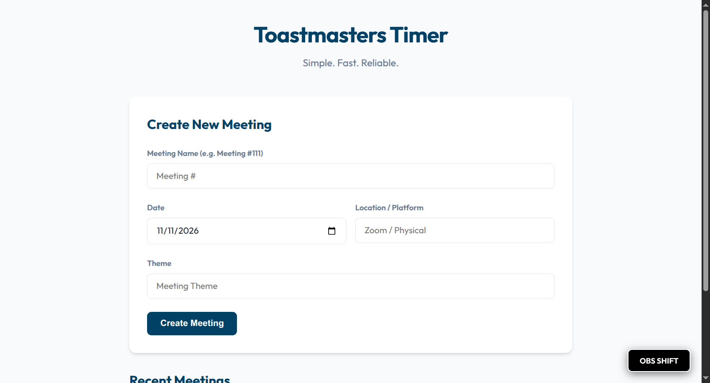
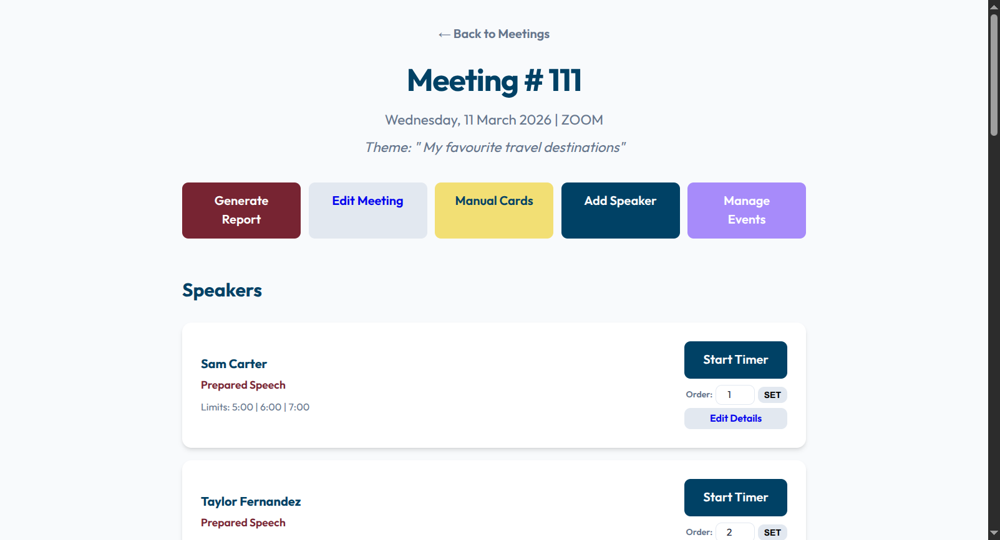
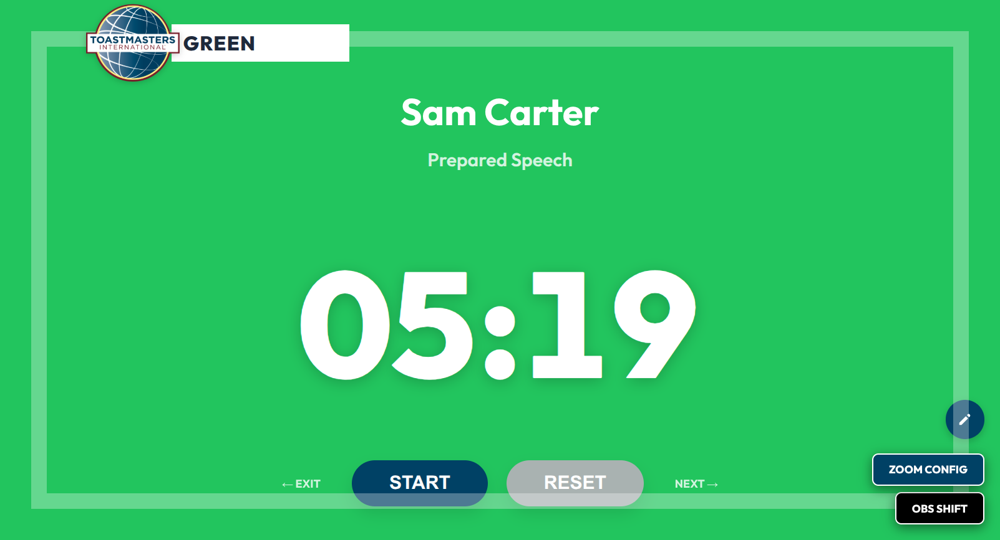
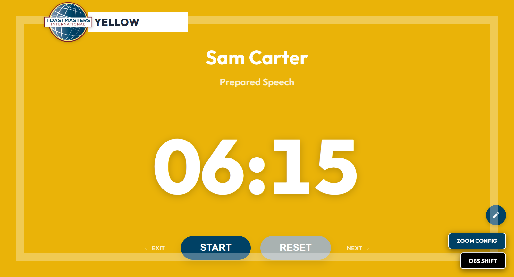
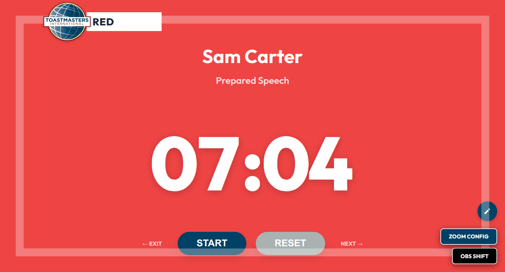
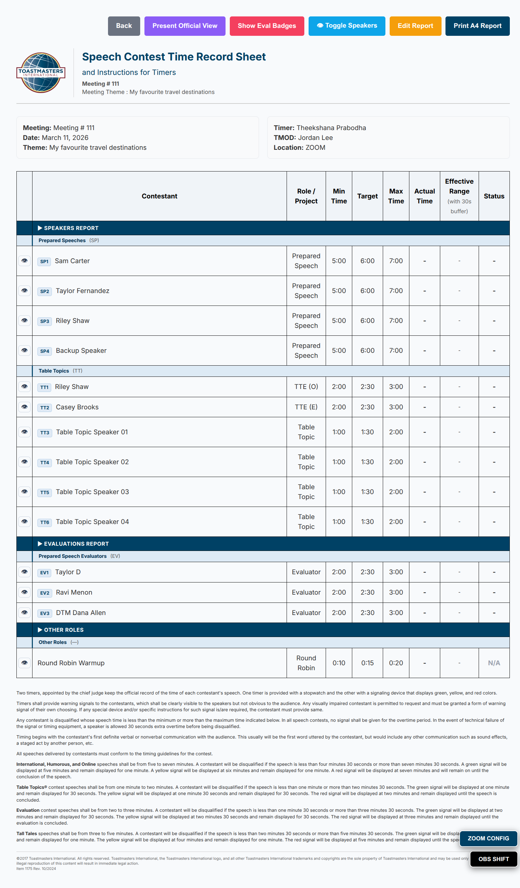

# Toastmasters Timer — Meeting Timing Web App


> A Dockerized web application that lets a Toastmasters Timer run live meeting timing, manage a speaker roster, and generate a print-ready A4 report — all from a browser on a projector screen.

---

## The Problem It Solves

Live Toastmasters meetings are time-sensitive and frequently chaotic. Agendas shift at the last minute, speakers swap positions, and the Timer needs to signal the entire room clearly without losing focus. Paper timing sheets introduce errors, and generic stopwatch apps have no concept of Toastmasters roles or thresholds.

This tool was built to solve all three problems: **roster flexibility**, **room-visible color signaling**, and **automatic reporting**.

---

## Screenshots

| Meeting setup | Roster & reordering |
|---|---|
|  |  |

**Full-screen colour cards** — the whole tab changes colour at each role's thresholds, readable from across the room:

| Green | Yellow | Red |
|---|---|---|
|  |  |  |

**Print-ready A4 report:**



---

## Key Features

| Feature | Description |
|---|---|
| 🎨 **Full-screen Color Cards** | The entire browser tab turns Green, Yellow, or Red at role-specific thresholds — visible from across a large room |
| 🔢 **Conflict-free Reordering** | Type a sequence number to move any speaker; conflicts resolve automatically |
| ⏱ **Round Robin Mode** | 20-second limit with a single clean red cue — no premature alerts |
| 📄 **A4 Print Report** | One-click report with out-of-time highlighting, formatted for A4 paper |
| ✏️ **Inline Quick Edit** | Edit speaker name, role, or timing thresholds without a page reload |
| 🗓 **Auto Day-of-Week** | Calculates and displays the correct weekday from the selected meeting date |
| 🔄 **Reusable Roster** | "Clear All Times" resets a meeting's recorded times while keeping the speaker list |
| 🗂 **Custom Event Types** | Create and save custom roles with unique timing thresholds (e.g., Q&A Session) |
| 📋 **Indexed Report** | Report groups Prepared Speeches and Table Topics first, Evaluations second — matching the Timer's live report flow |

---

## Architecture Overview

```
┌─────────────────────────────────────────────────┐
│                  Browser (Client)                │
│   meeting.php │ timer.php │ report.php           │
│   Vanilla JS  │  AJAX     │  CSS @media print    │
└──────────────────────┬──────────────────────────┘
                       │ HTTP / AJAX
┌──────────────────────▼──────────────────────────┐
│              PHP 8.2 + Apache (Docker)           │
│   index.php  │  src/db.php  │  src/event_types  │
└──────────────────────┬──────────────────────────┘
                       │ PDO / MySQL
┌──────────────────────▼──────────────────────────┐
│              MySQL 8.0 (Docker)                  │
│   meetings  │  speakers  │  event_types          │
└─────────────────────────────────────────────────┘
```

**Design principles:**
- No framework dependencies — pure PHP, JS, and CSS for maximum longevity
- Client-side stopwatch for real-time accuracy independent of network latency
- All timing thresholds driven by database-stored role definitions
- Docker Compose ensures a one-command, repeatable deployment

---

## Timing Rules

| Role | Green | Yellow | Red |
|---|---|---|---|
| Prepared Speech (standard) | 5:00 | 6:00 | 7:00 |
| Ice Breaker Speech | 4:00 | 5:00 | 6:00 |
| Table Topic | 1:00 | 1:30 | 2:00 |
| Evaluator | 2:00 | 2:30 | 3:00 |
| Round Robin | — | — | 0:20 |
| Custom (user-defined) | configurable | configurable | configurable |

---

## One-Command Setup

### Prerequisites

- [Docker](https://docs.docker.com/get-docker/) with the Compose plugin, installed and running

### Start the App

```bash
cp .env.example .env      # then fill in DB_PASSWORD and DB_ROOT_PASSWORD (no defaults)
docker compose up -d --build
```

Open [http://localhost:8080](http://localhost:8080) and create an account. Each account sees only its own meetings. For live-editing source locally, copy `docker-compose.override.yml.example` to `docker-compose.override.yml`.

### Stop the App

```bash
docker compose down
```

### Reset the Database

```bash
docker compose down -v
docker compose up -d
```

---

## Shared Hosting (PHP + MySQL)

Requires PHP 8.1+ with `mysqli`, MySQL 5.7+/MariaDB 10.4+.

1. Create a database and user in your host's control panel.
2. Upload the repository. **Point the domain's document root at `public/`.** If the host can't, the root `.htaccess` routes into `public/` and blocks everything else; check `/src/db.php` and `/config.php` return 403/404.
3. Copy `config.sample.php` to `config.php` (it lives outside `public/`) and fill in the database settings.
4. Import `sql/schema.sql` (phpMyAdmin), or on a shell run `php bin/migrate.php` against an existing pre-login database and then `php bin/migrate.php --adopt-email=you@example.com` after registering, to assign old meetings to your account.
5. Serve over HTTPS (cookies are marked `Secure` automatically when HTTPS is detected).

### InfinityFree (and other FTP-only hosts)

InfinityFree fixes the web root to `htdocs/` and has no SSH, so use the packager instead of uploading the repo:

```bash
bin/package-infinityfree.sh        # builds dist/infinityfree/{htdocs,database}
```

1. In the InfinityFree panel create a MySQL database. The host is shown there (`sqlNNN.infinityfree.com`), not `localhost`.
2. phpMyAdmin: import `dist/infinityfree/database/schema.sql`.
3. Edit `dist/infinityfree/htdocs/config.php` with the host, database, user and password (kept on re-runs).
4. FTP the contents of `dist/infinityfree/htdocs/` (including the hidden `.htaccess` files) into the host's `htdocs/`.
5. Turn on the free SSL certificate in the panel, then open the site over `https://`.

`.htaccess` blocks `src/`, `config.php` and the other non-public folders, and the packager leaves `sql/`, docs and tests out. `bin/migrate.php` needs a shell, so it is for upgrading local or VPS installs only.

### Limits and retention

Free hosts have small quotas, so the app tidies itself. Meetings are removed 30 days after their meeting date (accounts stay), each user can hold 20 meetings with up to 40 speakers each, and users see a usage meter on their dashboard with one-click deletion when they are near or at a limit. There is no cron on these hosts: the first request after 24 hours runs the cleanup (`src/maintenance.php`). Users choose what to delete: tick meetings on the dashboard, then export CSV or print-ready reports (use Print, Save as PDF) with Qualified/Grace/Disqualified badges, review, and delete. Dashboard warnings appear 7 days before automatic removal. Tune `retention_days`, `max_meetings` and `max_speakers` in `config.php`. Existing databases need `sql/migrations/002_app_state.sql` (phpMyAdmin import, or `php bin/migrate.php` where you have a shell).

## Tests

```bash
php tests/run.php          # unit tests for validation, grading and escaping helpers
tests/smoke.sh             # against a running stack: auth, CSRF, cross-user isolation, escaping
```

---

## Repository Map

```
toastmasters-timer/
├── docker-compose.yml, Dockerfile*   # Local/containerised run
├── config.sample.php                 # Copy to config.php (hosting)
├── public/                           # Document root
│   ├── index.php, meeting.php, timer.php, report.php, cards.php
│   ├── login.php, register.php, logout.php
│   ├── blog.php, about.php, contact.php  # public pages (blog posts live in src/blog/)
│   ├── api/                          # JSON endpoints (save_time, event_types)
│   ├── css/, js/, fonts/             # Assets (fonts self-hosted)
├── src/                              # Bootstrap, auth, CSRF, validation, grading (not web-served)
├── sql/                              # schema.sql, migrations/, seed-demo.sql
├── bin/migrate.php
└── tests/
```

---

## Workflow

1. **Before the meeting** — Open the meeting, verify or adjust the speaker roster and sequence order.
2. **During Table Topics / Speeches** — Navigate to the Timer page. Start the stopwatch; the screen signals green, yellow, and red automatically.
3. **During Evaluations** — Same flow with evaluator-specific thresholds.
4. **Timer's Report** — Open the Report page; copy or print the indexed, role-grouped report.

---

## Project Story

The real story is how this tool was shaped by live meeting constraints and iterative tuning. See [`DEVELOPMENT_STORY.md`](DEVELOPMENT_STORY.md) for the full narrative.

---

## Technical Implementation

For database schema, component design decisions, and the custom event types system, see [`IMPLEMENTATION_NOTES.md`](IMPLEMENTATION_NOTES.md).

## Docs

- DevOps & Production checklist: [DEVOPS.md](DEVOPS.md)
- Ubuntu beginner setup & developer workflow: [UBUNTU-BEGINNER.md](UBUNTU-BEGINNER.md)

---

## AI Collaboration

Built as a **human-in-the-loop project** with Google Antigravity. I supplied the Toastmasters domain knowledge — timing rules, meeting workflow, UX constraints, and acceptance criteria. The AI agent accelerated implementation and iteration cycles.

The design decisions, workflow priorities, and real-meeting validation were entirely human-driven.

---

## Disclaimer

This is an independent, community-built tool. It is not affiliated with or endorsed by Toastmasters International; "Toastmasters" and its logo are trademarks of Toastmasters International.

---

## License

MIT — see [`LICENSE`](LICENSE).
